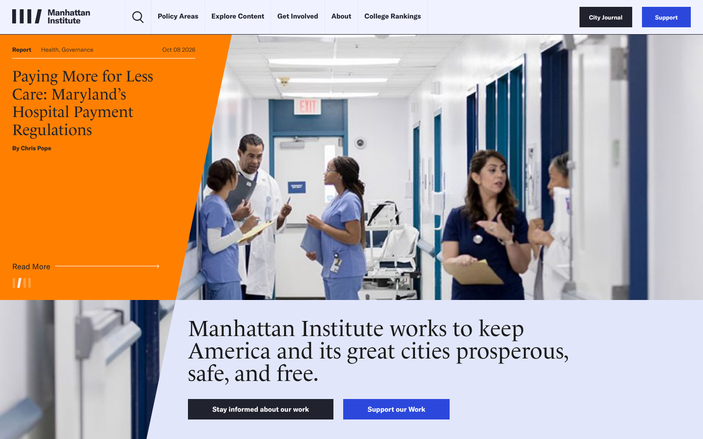
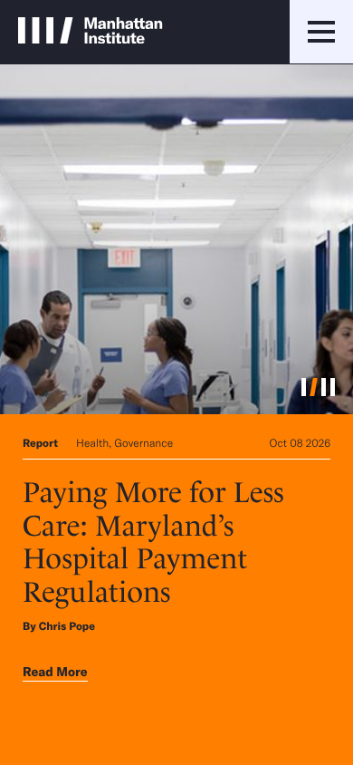

# Manhattan Institute: design extraction

**Source:** https://manhattan.institute/ · **Extracted:** 2026-10-10 · **Stack:** WordPress (`mi-theme`), Swiper, Slick, Osano consent, Piano

This is the first extraction in this repo produced by the full `designlang`
browser pipeline: 2,088 rendered elements analysed with computed styles,
runtime motion capture, and real screenshots. The earlier extractions had to
be reconstructed from CSS fetched with `curl`. See [Method](#method).

## The design in brief

An editorial think-tank identity: a **serif headline voice over a grotesque
UI**, a cool lavender-tinted page, and one hot accent.

**Colour.** Painted-area dominance, measured on the rendered page:

| Colour | Share | Role |
|---|---|---|
| `#f0f3ff` | 45% | page ground, a cool lavender-white rather than pure white |
| `#20222e` | 20% | ink navy: mobile header, "City Journal" and secondary buttons |
| `#e1e6fa` | 18% | tinted surface for the mission band and raised sections |
| `#ff8000` | 8% | **signal orange**, the hero story panel |
| `#2c48dc` | 5% | primary action blue ("Support"); white on it is 6.85:1 (AA) |
| `#00afcf` | 5% | cyan accent |

Text is `#1a1a1a` (1,233 uses) rather than pure black.

**Type.** Two families with separate jobs:
- **Le Monde Livre** (serif) for headlines, set large and light: the hero title and the mission statement.
- **GT America** (grotesque) for everything structural: nav, labels, buttons, metadata (357 elements). Bold at small sizes.
- The scale sits on a **1.125 (major second)** ratio anchored at 22px, and 100% of the sizes in use land on it. Display tops out at 128px. Measure is about 72 characters.

**Shape.** Fully square. The site's own elements carry **no border-radius at
all**. (The 4px / 40px / 50px radii from a first pass belonged to the cookie
banner and promo modal.) Elevation is effectively flat: one shadow,
`0 2px 8px rgba(0,0,0,.08)`, used once. Hierarchy comes from colour blocks and
type, not depth.

**Signature details**
- **The diagonal cut.** The orange hero panel ends in a slanted edge that bites into the photograph, and a second diagonal separates the photo from the mission band below. It's the strongest graphic move on the page, and it's pure geometry with no animation.
- **The logo as UI.** The logomark (four vertical bars, one slashed, `IIII/`) is reused as the hero's slide indicator, with the active slide's bar slanted.
- **Ink + blue button pair.** Secondary actions are navy `#20222e` and primary actions are blue `#2c48dc`. The two sit side by side in the header ("City Journal" / "Support") and again in the mission band.

| Mobile | Tablet |
|---|---|
|  |  |

## Motion

Restrained and editorial: `200ms ease-out` for hover/focus colour changes,
`500ms ease` scroll-in fades, and a `1000ms` two-layer crossfade on the hero,
which autoplays every 5s. There are no springs and no scroll-scrubbed
animation. Full write-up, including what the runtime capture saw versus what
was recovered from the JS bundle:
**[manhattan-institute-motion-graphics.md](manhattan-institute-motion-graphics.md)**

## Files

| File | What it is |
|---|---|
| `manhattan-institute-design-language.md` | Full generated design system (palette, tonal ramps, type scale, spacing, components); written for LLM consumption |
| `manhattan-institute-DESIGN.md` | Condensed single-file version |
| `manhattan-institute-motion-graphics.md` | Curated motion analysis (hand-written) |
| `manhattan-institute-preview.html` | Visual report: swatches, type specimens |
| `manhattan-institute-brand-book.html` | Brand-book layout of the same tokens |
| `manhattan-institute-motion-lab.html` | Interactive viewer for the motion tokens |
| `manhattan-institute-design-tokens.json` | W3C DTCG tokens |
| `manhattan-institute-figma-variables.json` | Figma Variables import |
| `manhattan-institute-variables.css` | CSS custom properties |
| `manhattan-institute-tailwind.config.js` / `-tailwind-v4.css` | Tailwind v3 config / v4 `@theme` |
| `manhattan-institute-shadcn-theme.css` | shadcn/ui theme |
| `manhattan-institute-theme.js` | React / CSS-in-JS theme object |
| `manhattan-institute-motion.css`, `-motion-framer.js`, `-motion-one.js`, `-motion-tailwind.js` | Motion presets; see the caveat below |
| `manhattan-institute-raw.json` | Complete raw extraction, including every runtime motion observation |
| `screenshots/` | Viewport + full-page PNGs at 390 / 768 / 1280 / 1440px |

## Caveats

1. **Third-party overlays were stripped.** The page loads with an Osano cookie banner and a Piano promo modal on top. Both were removed before extraction and screenshots (`.osano-cm-window`, `.tp-modal`, `.tp-backdrop`, `.tp-iframe-wrapper`). Without that, Osano's `#20222e` dialog was being reported as the site's "raised surface". (`#20222e` does turn out to be a genuine brand colour as well; see the mobile header.)
2. **Third-party custom properties are still in `variables.css` and the design-language file.** Removing the DOM elements doesn't unload a stylesheet's `:root` variables. Drop every `--osano-*` (cookie banner) and `--wp--preset--*` (WordPress core defaults) variable when reusing the tokens. None of them are Manhattan Institute brand values.
3. **The motion preset files mix observed values with generic scaffolding.** The durations are real. The `slide-up` / `scale-in` / `pop` keyframes, the Framer "soft" spring, and the Framer easing array are defaults added by the generator, not things this site does. The motion write-up has a line-by-line breakdown.
4. **The automated WCAG pass found no colour pairs** once the overlays were removed (it reports "100% — 0 passing, 0 failing", which is vacuous). Use the **Semantic Pairs** table in the design-language file instead. Every pair there passes: page text 18.97:1, primary button 6.85:1, orange panel 8.34:1.
5. **No `prefers-reduced-motion` handling.** This was checked in the theme CSS, the custom CSS, inline styles, and the JS bundle. The hero crossfade autoplays with no pause control.
6. **Single page.** Only the homepage was crawled.

## Method

Headless Chromium had been failing HTTPS in this environment (see the earlier
extractions). It works in this container with the pre-installed **Chromium
141** build. `designlang`'s own Playwright expects a newer Chromium (156) that
isn't installed here, so the extraction ran through designlang's programmatic
API (`extract()` + `RENDERERS`) with `executablePath` pointed at the installed
browser, using `motionRuntime` and `deepInteract`. Screenshots were taken
separately with the same browser, after scrolling the full page so the
scroll-triggered fades had resolved.
